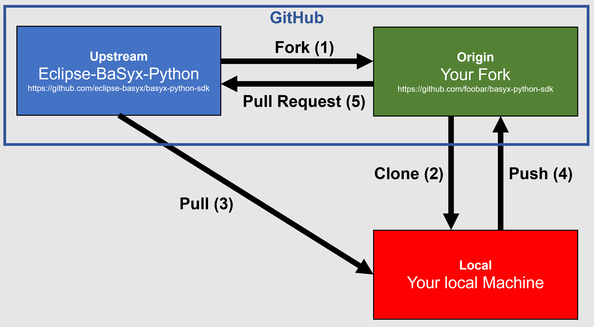

# Contributing Guide

> [!NOTE] 
> To contribute code, you must sign the [Eclipse Contributor Agreement (ECA)](#eclipse-contributor-agreement-eca).

Thank you for investing your time in contributing to the Eclipse-BaSyx-Python SDK!

In this guide you will get an overview of the contribution workflow from opening an
issue, creating a PR, reviewing, and merging the PR.

Furthermore, it gives some guidelines on how to write commit and pull
request messages, as well as on codestyle and testing.

## Issues

In order to open an issue, go
to https://github.com/eclipse-basyx/basyx-python-sdk/issues and click "**New Issue**".

The first step for a good issue is a descriptive title. The title is a brief description
of the issue, ideally 72 characters or fewer using imperative language.
Furthermore, if you know which module is the cause of your issue, please mention 
it at the beginning of the issue title.

Here are some example for a good title:

```
model.datatypes: Missing type `xs:someThingMadeUp`
compliance_tool: Fail to check aasx package without thumbnail
adapter.aasx: `Property.value` `0` are converted into `NoneType`
```

As you can see, inline code blocks (the backticks) are used to highlight 
class names or types.

In the issue message, use full text or bullet points to describe your issue in detail.
Please include a short paragraph on each of

- Expected behavior:  A description of what the expected behavior should be, so that
  maintainers can understand how the issue differs from the intended functionality.
- Actual behavior: A description of what is actually happening, which can help pinpoint
  the cause of the issue.
- Environment: Information about the operating system, the SDK version used, the version
  of the specification used, or other relevant technical details that may be
  contributing to the issue.

Additionally, if you have ideas on how to address the issue, please include them here!

## Contribute Changes
### Eclipse Contributor Agreement (ECA)
Before contributing, please make sure, you fill out
the [Eclipse Contributor Agreement (ECA)](https://www.eclipse.org/legal/ECA.php). This
is done by creating an Eclipse account for your git e-mail address and then submitting
the following
form: [https://accounts.eclipse.org/user/eca](https://accounts.eclipse.org/user/eca).
The E-Mail address used to sign the ECA is the same one that needs to be used for
committing.

### Workflow

The default branch of Eclipse-BaSyx-Python is `develop`.
All contributions go there, so every pull request must target `develop`.
The `main` branch only receives releases.

After this, the workflow to submit contributions to Eclipse-BaSyx-Python is pretty
standard, as the picture (based
on [this blog-post by Tomas Beuzen](https://www.tomasbeuzen.com/post/git-fork-branch-pull/))
below shows:



1. Fork the Eclipse-BaSyx Repository
2. Clone your fork to your development machine and add Eclipse-BaSyx as `upstream`:

```bash
git remote add upstream https://github.com/eclipse-basyx/basyx-python-sdk
```

3. Pull the `develop` branch:

```bash
git pull upstream develop
```

Now, you can create a new local branch in which you can create your changes and actually
do your changes. The name of the branch does not matter much. When you're done with that,
continue with:

4. Push the new branch to your fork:

```bash
git push origin <your_new_branch>
```

5. Create a [Pull Request](https://github.com/eclipse-basyx/basyx-python-sdk/pulls) from
   your fork `<your_new_branch>` to the Eclipse-BaSyx-Python `develop` branch

The Eclipse-BaSyx-Python maintainers will then review the pull request and communicate
the further steps via the comments.

### Merging Pull Requests

Pull requests are merged with *Squash and merge*: All commits of your branch become
a single commit on `develop`.
The title and description of the pull request become the title and message of this
commit, and GitHub appends the PR number to the title, e.g. `(#123)`.

The release notes are written from the commit history of `develop`.
Therefore, the title and description of your pull request are very important and must
follow the [guidelines below](#commit-and-pull-request-messages).
The individual commits on your branch are lost in the squash, so their messages matter
less.
The maintainers may edit the title and description before they merge.

The only exception are releases: The release pull request from `develop` to `main` is
merged with a merge commit.
Afterwards, `main` is merged back into `develop`, so that the release tag is also part
of the history of `develop`.

## Commit and Pull Request Messages

In order to effectively communicate, there are some conventions to respect when writing
commit messages and pull requests.

Commit messages and pull request messages are essentially the same thing: The title and
description of your pull request become the squash commit on `develop`
(see [Merging Pull Requests](#merging-pull-requests)).
If you write a good commit message, GitHub fills it in as the PR title and description
automatically, so you only need to write it once.

### Title

The title should be as short as possible, ideally 50 characters or fewer.
Only exceed this if truly necessary.
Use imperative language and no period at the end.
If a specific module is affected, please mention it at the beginning of the title.

Here are some examples:

```
model.datatypes: Add type `xs:someThingMadeUp`
compliance_tool: Fix fail to check aasx package without thumbnail
adapter.aasx: Fix `Property.value` `0` converted into `NoneType`
```

### Message

The following guidelines are for the commit or PR message text:

- Max. 72 characters per line (except for link definitions, see below)
- No imperative, full sentences, bullet points where helpful
- Every message should convey these three things:
    1. Previous state: What was the situation before this change?
    2. Motivation: Why do we change it now? Sometimes, this is already clear from the
       previous state.
    3. What changed: A high-level description of the approach. The details can be
       looked up in the code.
- Write as short as possible, while still being complete
- Use backticks for class names, method names, file names, or any other identifiers
- Reference issues and pull requests inline as `#123`
- Where sensible, reference the specification via its HTML version, e.g.
  `https://industrialdigitaltwin.io/aas-specifications/IDTA-01001/v3.2/index.html`
- If a URL is too long for a line, use a reference-style link: Write `[some text]`
  inline and add the link definition `[some text]: https://...` at the very end
- If applicable, close the respective issues with `Fixes #123` after the message
  text and before any link definitions

Here are two examples:

```
Increase `adapter.aasx` test coverage

Previously the test coverage in the `basyx.aas.adapter.aasx` package
was suboptimal. The `AASXWriter` class was tested end-to-end in
combination with `AASXReader` but special cases, that lead to
exceptions were not covered. Additionally the `load_directory(...)`
method of the `basyx.aas.adapter` package was untested.

With these changes additional tests are added which cover the code
parts that are mentioned above.

Fixes #127
```

```
Revert "[V3] Fix missing literal in `FragmentKeys` (#337)"

Previously, we thought that we missed the literal `Referable` in
`FragmentKeys`. In #337, we introduced that literal, together with all
the logical problems and paradoxes that come with it.

However, as it turns out, it was a bug in the specification, rather
than our mistake. Therefore, we revert the changes of commit
f41646aa4baa5807cefeb4c3bb95f7937d001b50 here.

See [aas-core-works/aas-core3.0-python#37] for the discussion, as it
was discovered there.

Fixes #322

[aas-core-works/aas-core3.0-python#37]: https://github.com/aas-core-works/aas-core3.0-python/issues/37
```

## Code Quality

The Eclipse BaSyx Python project emphasizes high code quality.
To achieve this, we apply best practices where possible and have developed an extensive suite of tests that are 
expected to pass for each Pull Request to the project. 

### Codestyle
Our code follows the [PEP 8 -- Style Guide for Python Code](https://www.python.org/dev/peps/pep-0008/)
with the following exceptions:
- Line length is allowed to be up to 120 characters, though lines up to 100 characters are preferred.

Additionally, we use [PEP 484 -- Type Hints](https://www.python.org/dev/peps/pep-0484/) throughout the code to enable type checking the code.

Before submitting any changes to the SDK, make sure to let `mypy` and `pycodestyle` check your code and run the unit 
tests with Python's builtin `unittest`. 

### Testing
There are many automated checks implemented in the CI pipelines of this project, all of which are expected to pass 
before new code can be added:

- We check that the Python packages can be built.
- We run the developed unittests and aim for a code coverage of at least 80%.
- We perform static code analysis for type-checking and codestyle, not just in the code itself, but also in codeblocks 
  that are inside docstrings and the `README.md`.
- We apply a set of [ruff](https://docs.astral.sh/ruff/) linter rules (see [ruff.toml](ruff.toml)) to ensure a certain 
  codestyle and prevent issues / bad practices to arise.
- We check that the automatically generated developer documentation compiles.
- We check that the Python Versions we support match between the different subprojects in the monorepository and are 
  not End of Life.
- We check that the year in the copyright headers in each file (stemming from the license) is correct.

> [!note]
> We strongly suggest to run the tests locally, before submitting a Pull Request, in order to accelerate the review 
> process. 

### Testing the SDK
For testing the SDK locally on your machine, you can install the required tools like so:
```bash
pip install .[dev]
```

> [!note]
> The `.` denotes the current directory and needs to be the directory the `pyproject.toml` is located in.
> Therefore, you need to run this command and the ones below in the `/sdk` directory (relative to the repository root).

Running all checks:
```bash
ruff check
mypy basyx test
python -m unittest
coverage run --source basyx --branch -m unittest
coverage report -m
```

We aim to cover our code with tests by at least 80%.

This should help you sort out the most important bugs in your code.
Note that there are more checks that run in the CI once you open a Pull Request.
If you want to run the additional checks, please refer to the [CI definition](./.github/workflows/pr.yml).

### Testing the Server
For testing the server locally, you need to install the required tools. To do so, run the following command in the 
`/server` directory (relative to the repository root).

```bash
pip install .[dev]
```

Afterward, you are ready to run the checks locally:
```bash
ruff check
mypy app test
python -m unittest
coverage run --source app --branch -m unittest
coverage report -m
```

We aim to cover our code with tests by at least 80%.

Additionally, you should check that the Docker image builds succeed and the containers start without error. 
For that, you need to have Docker installed on your system. 
Run the following commands in the `server` directory: 
```bash
ruff check
docker build -t basyx-python-repository -f docker/repository/Dockerfile --build-context sdk=../sdk --build-context license=.. .
docker run --name basyx-python-repository basyx-python-repository
```
Replace `repository` with `discovery` or `registry` to test the other server profiles.
Wait until you see the line:
```
INFO success: quit_on_failure entered RUNNING state
```
This should help you sort out the most important bugs in your code.
Note that there are more checks that run in the CI once you open a Pull Request.
If you want to run the additional checks, please refer to the [CI definition](./.github/workflows/pr.yml).


### Testing the Compliance Tool
For the Compliance Tool, you can install the required tools like this (from the `./compliance_tool` directory):
```bash
pip install -e ../sdk[dev]
pip install .[dev]
```
The first line installs the SDK and its dependencies, the second the developer dependencies for the compliance tool
itself.

Then you can run the checks via:
```bash
ruff check
mypy basyx test
python -m unittest
coverage run --source basyx --branch -m unittest
coverage report -m
```

We aim to cover our code with tests by at least 80%.
This should help you sort out the most important bugs in your code.
Note that there are more checks that run in the CI once you open a Pull Request.
If you want to run the additional checks, please refer to the [CI definition](./.github/workflows/pr.yml).
